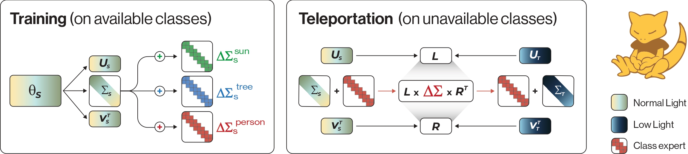

# [PRL] ABRA: Teleporting Fine-Tuned Knowledge Across Domains for Open-Vocabulary Object Detection

[](https://your-project-page.github.io)
[](https://arxiv.org/abs/xxxx.xxxx)
[](https://opensource.org/licenses/MIT)

This is the official repository for the PRL paper (under review): **"ABRA: Teleporting Fine-Tuned Knowledge Across Domains for Open-Vocabulary Object Detection"**.

> **Abstract:** *Although recent Open-Vocabulary Object Detection architectures, such as GDINO, demonstrate strong zero-shot capabilities, their performance degrades significantly under domain shifts. Moreover, many domains of practical interest, such as nighttime or foggy scenes, lack large annotated datasets, preventing direct fine-tuning. In this paper, we introduce Aligned Basis Relocation for Adaptation (ABRA), a method that transfers class-specific detection knowledge from a labeled source domain to a target domain where no training images containing these classes are accessible. ABRA formulates this adaptation as a geometric transport problem in the weight space of a pretrained detector, aligning source and target domain experts to transport class-specific knowledge. Extensive experiments across challenging domain shifts demonstrate that ABRA successfully teleports class-level specialization under multiple adverse conditions.*


*(Caption: Overview of the transfer pipeline. Starting from domain experts obtained through Objectification, class-specific residuals learned via SVFT in the source domain are analytically transported to unseen target domains.)*

---

## 🛠️ Installation

Before starting, choose one of the following environment setup options. Both options require Python 3.10 and the same follow-up steps for model weights and Deformable Attention.

### Option 1: Conda

```bash
conda create -n abra python=3.10
conda activate abra
```

Before installing the remaining packages, manually install **PyTorch 2.1.0** using the official PyTorch [previous versions guide](https://pytorch.org/get-started/previous-versions/).

Then install the project dependencies:

```bash
pip install -r requirements.txt
```

### Option 2: uv

Install [uv](https://docs.astral.sh/uv/getting-started/installation/) if it is not already available, then sync the locked environment from the repository root:

```bash
uv sync
source .venv/bin/activate
```

The uv configuration installs Python 3.10 or newer and uses the CUDA 11.8 PyTorch index on Linux. On other platforms, verify that the resolved PyTorch packages match your hardware and CUDA installation.

### Common setup steps

Compilation of Deformable Attention is required for running the detector. Follow step 2 in the [Open-GroundingDino repository](https://github.com/longzw1997/Open-GroundingDino).

Download the base Grounding DINO [weights](https://github.com/IDEA-Research/GroundingDINO) to the `weights/` directory.

---

## 📦 Model Weights and Dataset Splits

The following resources are required to reproduce the experiments. The ABRA release contains the project-specific weights and dataset split files.

| Resource | Link | Contents |
| --- | --- | --- |
| Pretrained Grounding DINO weights | [GroundingDINO repository](https://github.com/IDEA-Research/GroundingDINO) | Base detector checkpoint |
| ABRA release | [GitHub Releases](https://github.com/brunzibeer/ABRA/releases) | ABRA domain and class expert weights, dataset splits, and label maps |

The expected annotation structure and ODVG schema are described in [data_format.md](data_format.md).

---

## 📂 Dataset Preparation

ABRA evaluates domain transfer across multiple challenging conditions (e.g., clear weather to fog, day to night). For our primary benchmarks, we use **Cityscapes** (Source) and **Foggy Cityscapes** (Target). 

1. Download the datasets from their official websites.
2. Organize them into the `datasets/` directory following the structure below:

```text
datasets/
└── cityscapes/
    ├── normal/
    │   ├── annotations
    │   └── images
    |       ├── train
    |       └── val
    ├── fog/
    │   ├── annotations
    │   └── images
    |       ├── train
    |       └── val
    └── label_maps/
```
---

## 🏋️‍♂️ Domain Expert Training

The first step of the ABRA pipeline is **Objectification**. We train Domain Experts on both the Source and Target domains to learn robust, class-agnostic object localization capabilities tailored to the specific environmental conditions.

### 1. Train the Source Domain Expert (e.g., Cityscapes)
Train the base model on the source domain using only class-agnostic bounding boxes:
```bash
python main.py \
  --root datasets/cityscapes/normal/images \
  --output_dir path/to/output \
  --train_annotations datasets/cityscapes/normal/annotations/domains/annotations_train_domain.jsonl
  --test_annotations datasets/cityscapes/normal/annotations/annotations_val.json \
  --label_map datasets/cityscapes/label_maps/top_3.json \
  --objectify 1 \
  --model_cfg groundingdino/config/cfg_odvg.py \
  --weights /path/to/gdino/pretrain \
  --trainable encoder_attn --param_type default \
  --epochs 10 --batch_size 2 --accumulation_steps 1 \
  --optim adamw --lr 1e-4 --weight_decay 1e-4 --scheduler multi --step_milestones 7 9 \
  --lp_names ref_point_head sampling_offsets --lp_lr 1e-5 \
```

### 2. Train the Target Domain Expert (e.g., Foggy Cityscapes)
Train the target expert using the unlabeled (class-agnostic) target domain images:
```bash
python main.py \
  ---copy parameters above and change dataset---
```
---

## 🎯 Class Expert Training

Next, we extract class-specific knowledge. We fine-tune the Source Domain Expert on the labeled source domain using **Singular Value Fine-Tuning (SVFT)**. This isolates the class-specific residuals for each category (e.g., *bus*, *rider*, *train*) in the source domain.

```bash
python main.py \
  --root datasets/cityscapes/normal/images \
  --output_dir path/to/output \
  --train_annotations datasets/cityscapes/normal/annotations/experts/bus/annotations_train.jsonl
  --test_annotations datasets/cityscapes/normal/annotations/experts/bus/annotations_val.json \
  --label_map datasets/cityscapes/label_maps/experts/bus.json \
  --model_cfg groundingdino/config/cfg_odvg.py \
  --weights /path/to/gdino/pretrain \
  --finetuning /path/to/normal/domain/output/best.pth \
  --trainable encoder_attn --param_type default \
  --epochs 12 --batch_size 4 --accumulation_steps 1 \
  --optim adamw --lr 1e-2 --weight_decay 0.0 --scheduler multi --step_milestones 7 9 \
  --lp_names ref_point_head sampling_offsets --lp_lr 1e-3 \
  --svft 1 --svft_pattern banded --svft_diag 2 \
```
*Note: You can repeat this process for other classes by simply changing the annoations path.*

---

## 🚀 Method Evaluation

The core contribution of ABRA is analytically transporting the learned class residuals from the Source Domain Expert to the Target Domain Expert via **Aligned Basis Relocation**. This creates a fully functional, class-aware detector for the target domain *without* requiring any target domain class labels.
```bash
python main.py \
    --root datasets/cityscapes/fog/images \
    --output_root /path/to/output \
    --train_annotations datasets/cityscapes/fog/annotations/experts/bus/annotations_train.jsonl \
    --test_annotations datasets/cityscapes/fog/annotations/experts/bus/annotations_val.json \
    --label_map datasets/cityscapes/label_maps/experts/bus.json
    --model_cfg groundingdino/config/cfg_odvg.py \
    --weights /path/to/gdino/pretrain \
    --finetuning /path/to/normal/domain/output/best.pth \
    --svft 1 --svft_pattern banded --svft_diag 2 \
    --transporter abra \
    --source_class /path/to/normal/expert/output/best.pth \
    --test 1 \
```